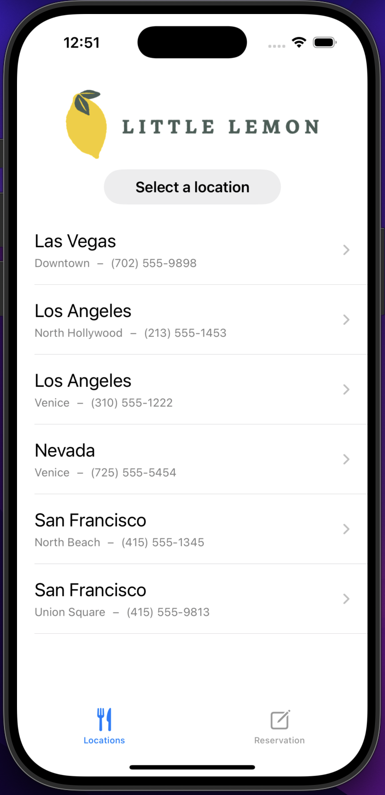
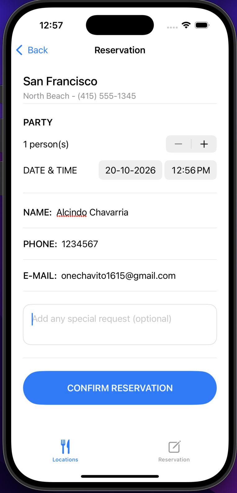
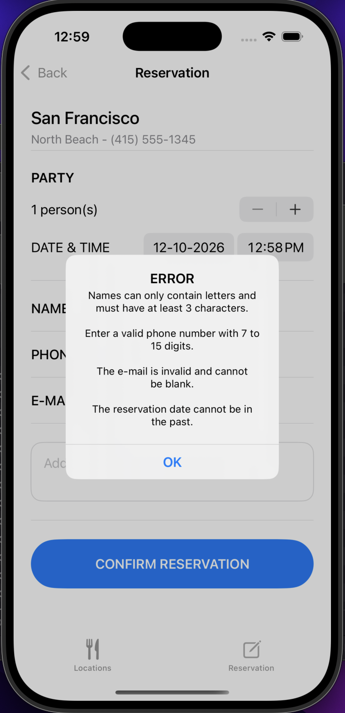
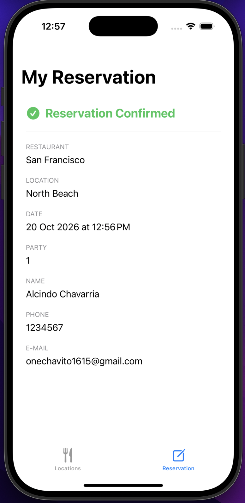

# 🍋 LittleLemonReservation

### Aplicación iOS de reservas de restaurante · Swift · SwiftUI · Xcode · Validación de formularios

---

**LittleLemonReservation** es una aplicación nativa para iOS desarrollada con **Swift y SwiftUI**, que permite seleccionar una sucursal del restaurante Little Lemon y gestionar reservas mediante un formulario interactivo.

La aplicación incorpora selección de restaurante, cantidad de personas, fecha y hora, ingreso de información personal, validación de campos y visualización de una confirmación con los detalles de la reserva. El proyecto fue desarrollado como parte del programa **Meta iOS Developer de Coursera**.

---

## 📱 Capturas de pantalla

<table>
  <tr>
    <td align="center">
      <strong>Selección de restaurante</strong>
        
      
    </td>
    <td align="center">
      <strong>Formulario de reserva</strong>
        
      
    </td>
  </tr>
  <tr>
    <td align="center">
      <strong>Validación de formulario</strong>
        
      
    </td>
    <td align="center">
      <strong>Confirmación de reserva</strong>
        
      
    </td>
  </tr>
</table>

